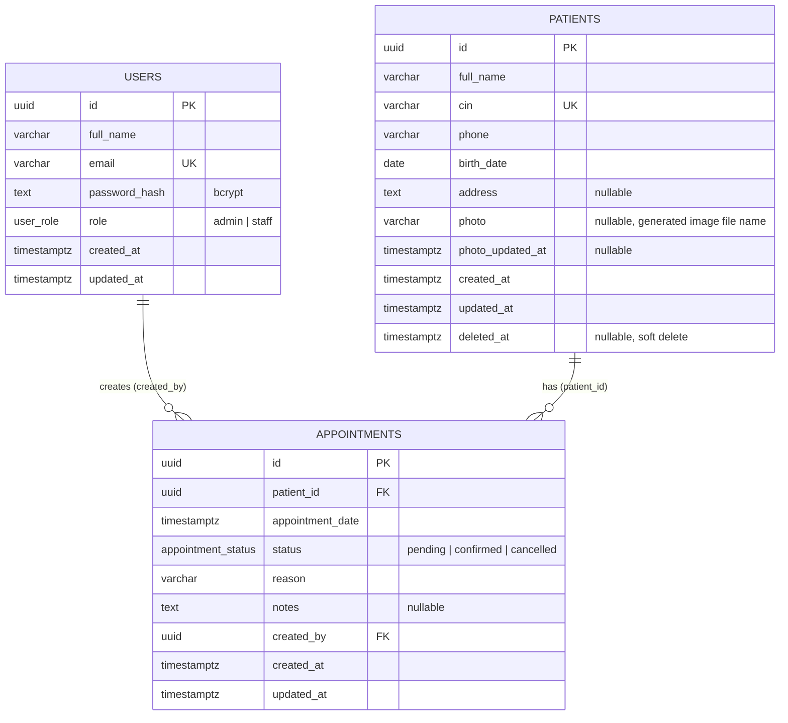

# ClinicFlow — Entity Relationship Diagram

> Full design document (in French: ERD, relationship justification, class diagrams): [docs/conception.md](../docs/conception.md)

## Relationships

| Relationship | Cardinality | Foreign key | ON DELETE | Why |
| --- | --- | --- | --- | --- |
| A user creates appointments | 1 : N | `appointments.created_by → users.id` | `RESTRICT` | Keeps the audit trail of who created each appointment. |
| A patient has appointments | 1 : N | `appointments.patient_id → patients.id` | `RESTRICT` | Patients are soft-deleted (`deleted_at`); a hard delete must never erase medical history. |

- An appointment belongs to exactly one patient and is created by exactly one user.
- There is no N:N relationship in this version.

## Constraints

| Table | Constraint |
| --- | --- |
| users | `UNIQUE(email)`, email stored lower-case, `password_hash` must be a bcrypt hash, role is the `user_role` ENUM |
| patients | `UNIQUE(cin)` (kept even after archiving), CIN stored upper-case, `birth_date` between 1900-01-01 and today |
| appointments | `status` is the `appointment_status` ENUM, non-blank `reason` |
| appointments | `EXCLUDE USING gist (patient_id WITH =, appointment_slot(appointment_date) WITH &&) WHERE (status = 'confirmed')` — no two confirmed appointments of the same patient less than 30 minutes apart |

`appointment_slot(t)` returns the range `[t, t + 30 min)`. Two such ranges overlap exactly when the
appointments are less than 30 minutes apart, so 10:00 and 10:15 conflict while 10:00 and 10:30 do not.

## Indexes

| Index | Purpose |
| --- | --- |
| `patients_cin_key` (unique, btree) | Exact CIN lookups and uniqueness |
| `patients_full_name_trgm_idx`, `patients_cin_trgm_idx` (GIN `pg_trgm`, partial `WHERE deleted_at IS NULL`) | `ILIKE '%term%'` search on active patients |
| `appointments_patient_id_date_idx (patient_id, appointment_date)` | Patient history, 30-minute rule lookup, FK checks |
| `appointments_date_idx (appointment_date)` | Date filter, today's appointments |
| `appointments_status_date_idx (status, appointment_date)` | Status filter, dashboard counters |
| `appointments_created_by_idx (created_by)` | FK checks on `users` |
| `appointments_no_confirmed_overlap` (GiST, partial) | Created by the exclusion constraint |

No separate index on `appointments.patient_id` or `appointments.status`: the composite indexes already cover them.
