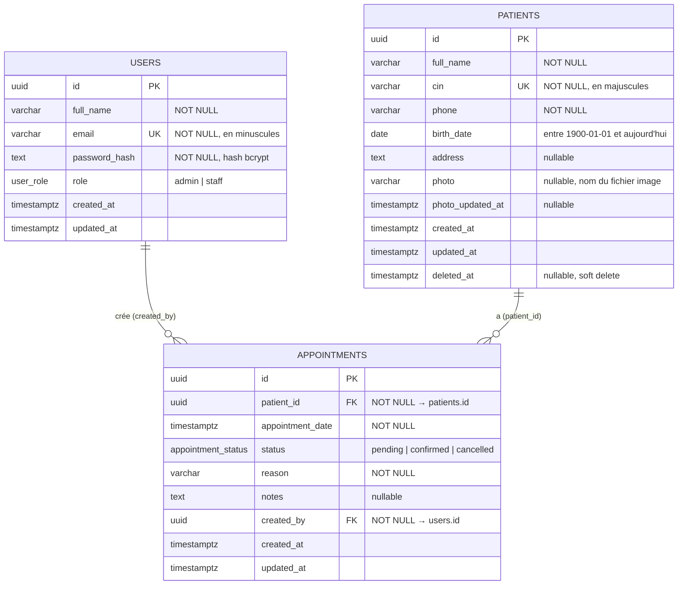
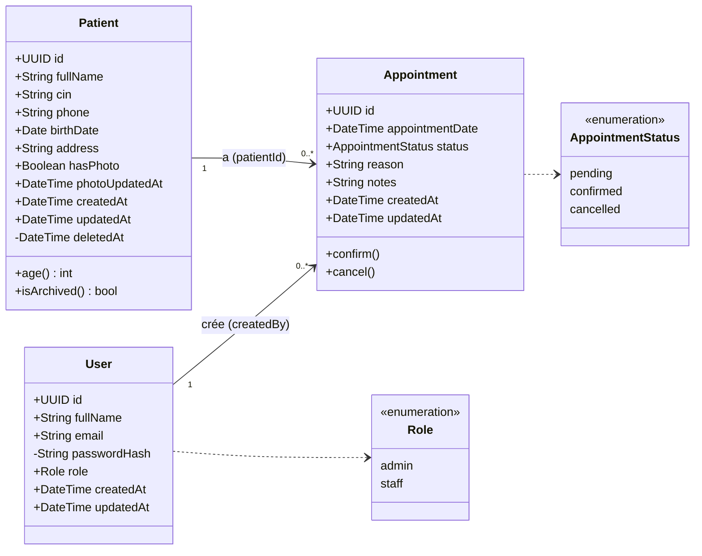
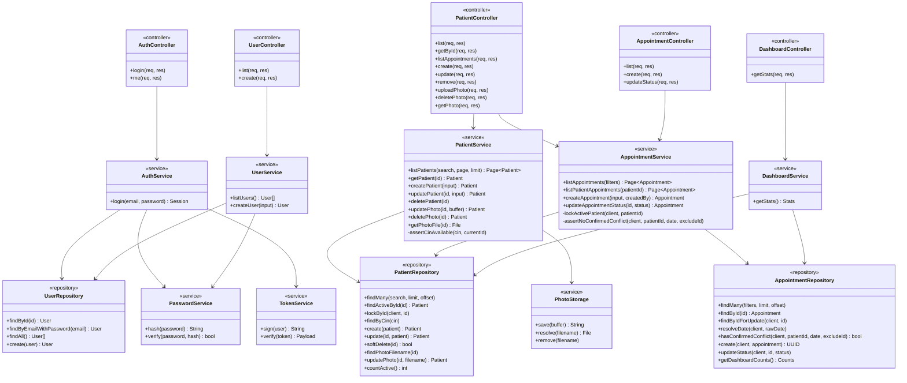

# ClinicFlow — Conception

Ce document décrit le schéma de la base de données, la justification des relations et la conception
objet (diagrammes de classes). Il reflète exactement les migrations `database/migrations/001` à `005`
et le code de `backend/src`.

---

## 1. Schéma de la base de données (ERD)



### Dictionnaire des données

**`users`** : comptes des employés de la clinique.

| Colonne | Type | Contraintes |
| --- | --- | --- |
| `id` | `UUID` | Clé primaire, `gen_random_uuid()` |
| `full_name` | `VARCHAR(150)` | Obligatoire, non vide |
| `email` | `VARCHAR(254)` | Obligatoire, **unique**, stocké en minuscules |
| `password_hash` | `TEXT` | Obligatoire, doit être un hash **bcrypt** (jamais le mot de passe en clair) |
| `role` | `user_role` (ENUM) | `admin` ou `staff`, `staff` par défaut |
| `created_at`, `updated_at` | `TIMESTAMPTZ` | `updated_at` mis à jour par trigger |

**`patients`** : dossiers des patients.

| Colonne | Type | Contraintes |
| --- | --- | --- |
| `id` | `UUID` | Clé primaire |
| `full_name` | `VARCHAR(150)` | Obligatoire, non vide |
| `cin` | `VARCHAR(20)` | Obligatoire, **unique**, stocké en majuscules |
| `phone` | `VARCHAR(20)` | Obligatoire |
| `birth_date` | `DATE` | Entre le 01/01/1900 et aujourd'hui |
| `address` | `TEXT` | Facultatif |
| `photo` | `VARCHAR(64)` | Facultatif ; nom de fichier généré par l'API (`<uuid>.jpg/png/webp`) |
| `photo_updated_at` | `TIMESTAMPTZ` | Renseigné si et seulement si `photo` l'est |
| `deleted_at` | `TIMESTAMPTZ` | `NULL` = actif ; une date = patient archivé (soft delete) |

**`appointments`** : rendez-vous.

| Colonne | Type | Contraintes |
| --- | --- | --- |
| `id` | `UUID` | Clé primaire |
| `patient_id` | `UUID` | Obligatoire, FK → `patients.id`, `ON DELETE RESTRICT` |
| `appointment_date` | `TIMESTAMPTZ` | Obligatoire (instant précis, fuseau de la clinique pour l'affichage) |
| `status` | `appointment_status` (ENUM) | `pending`, `confirmed` ou `cancelled` ; `pending` par défaut |
| `reason` | `VARCHAR(255)` | Obligatoire, non vide |
| `notes` | `TEXT` | Facultatif |
| `created_by` | `UUID` | Obligatoire, FK → `users.id`, `ON DELETE RESTRICT` ; vient du JWT |

**Règle des 30 minutes en base** : la contrainte d'exclusion
`EXCLUDE USING gist (patient_id WITH =, appointment_slot(appointment_date) WITH &&) WHERE (status = 'confirmed')`
interdit deux rendez-vous **confirmés** d'un même patient à moins de 30 minutes d'écart.
`appointment_slot(t)` renvoie l'intervalle `[t, t + 30 min)` ; deux intervalles se chevauchent exactement
quand l'écart est inférieur à 30 minutes. Ainsi, 10:00 et 10:15 sont en conflit, mais pas 10:00 et 10:30.

### Index

| Index | Rôle |
| --- | --- |
| `patients_cin_key` (unique) | Unicité et recherche exacte du CIN |
| `patients_full_name_trgm_idx`, `patients_cin_trgm_idx` (GIN trigram, partiels `WHERE deleted_at IS NULL`) | Recherche `ILIKE '%texte%'` rapide sur les patients actifs |
| `users_email_key` (unique) | Unicité et connexion par email |
| `appointments_patient_id_date_idx (patient_id, appointment_date)` | Historique d'un patient, vérification des 30 minutes, contrôles de FK |
| `appointments_date_idx (appointment_date)` | Filtre par date, rendez-vous du jour |
| `appointments_status_date_idx (status, appointment_date)` | Filtre par statut, compteurs du dashboard |
| `appointments_created_by_idx (created_by)` | Contrôles de FK sur `users` |

---

## 2. Relations et justification

| Relation | Cardinalité | Mise en œuvre |
| --- | --- | --- |
| Un **utilisateur** crée des **rendez-vous** | **1 – N** | `appointments.created_by → users.id` |
| Un **patient** a des **rendez-vous** | **1 – N** | `appointments.patient_id → patients.id` |

Cardinalités détaillées (notation Merise) :

```text
USERS     (0,n) ──── crée ────  (1,1) APPOINTMENTS
PATIENTS  (0,n) ──── a ───────  (1,1) APPOINTMENTS
```

### Pourquoi 1 – N

- **Utilisateur → rendez-vous (1-N).** Un membre du personnel enregistre de nombreux rendez-vous au fil du
  temps (0 à n), mais chaque rendez-vous a **un seul auteur** (exactement 1). Une clé étrangère
  `created_by` obligatoire (`NOT NULL`) côté « N » suffit. Elle est remplie à partir du JWT, jamais
  du corps de la requête, ce qui en fait une **trace d'audit** fiable.
- **Patient → rendez-vous (1-N).** Un patient peut avoir aucun, un ou plusieurs rendez-vous
  (consultation, suivi, contrôle...), mais un rendez-vous concerne **un seul patient**. D'où la
  clé étrangère obligatoire `patient_id`.

### Pourquoi pas de 1 – 1

Aucune donnée n'existe en exactement un exemplaire pour une autre entité tout en méritant sa propre table.
La **photo du patient** aurait pu être une table `patient_photos` en 1-1, mais elle ne contient qu'un nom
de fichier et une date : deux colonnes facultatives dans `patients` évitent une jointure, sans perte
d'intégrité. La contrainte `patients_photo_consistent` garantit qu'elles sont remplies ensemble.

### Pourquoi pas de N – N

- Un patient est vu par plusieurs employés, et un employé gère plusieurs patients. Mais ce lien passe
  **toujours par un rendez-vous**, qui a sa propre identité et ses propres données (date, statut, motif,
  notes). Ce n'est donc pas une simple table de jointure : `appointments` est une **entité** reliée par
  deux relations 1-N.
- `created_by` désigne **l'auteur** du rendez-vous, pas un médecin traitant. Il n'y a pas, dans cette
  version, d'affectation de médecins à des patients ni de spécialités multiples, qui seraient les cas
  typiques de N-N (par exemple une table `doctor_specialties`).

### Règles `ON DELETE`

| Clé étrangère | Règle | Justification |
| --- | --- | --- |
| `appointments.patient_id` | `RESTRICT` | Les patients sont **archivés** (`deleted_at`), jamais supprimés : l'historique médical est conservé. `RESTRICT` empêche qu'un `DELETE` SQL accidentel efface les rendez-vous (un `CASCADE` les supprimerait silencieusement). |
| `appointments.created_by` | `RESTRICT` | Préserve la traçabilité « qui a créé ce rendez-vous ». Il n'y a pas de suppression d'utilisateur dans l'API. |

---

## 3. Diagramme de classes

Le backend est écrit en JavaScript avec des **modules de fonctions** (pas de classes ES6). Les diagrammes
ci-dessous représentent ces modules comme des classes UML : le premier modélise le **domaine métier**,
le second l'**architecture en couches** avec les fonctions réellement exposées par chaque module.

### 3.1 Modèle du domaine

Les attributs correspondent aux objets JSON de l'API (camelCase). Le repository fait la conversion
depuis les colonnes SQL (snake_case), par exemple `full_name AS "fullName"`.



Image : [diagramme-classes-domaine.png](images/diagramme-classes-domaine.png) ([SVG](images/diagramme-classes-domaine.svg))

Règles métier portées par le modèle :

- **`Appointment.confirm()`** refuse (HTTP 409) si le même patient a déjà un rendez-vous `confirmed` à
  moins de 30 minutes. Implémenté dans `appointmentService.updateAppointmentStatus` et
  `createAppointment`, puis garanti en base par la contrainte d'exclusion.
- **Patient archivé** (`deletedAt` renseigné) : il n'apparaît plus dans les listes et ne peut plus
  recevoir de nouveau rendez-vous ni de confirmation. L'annulation reste possible.
- **`passwordHash`** est privé : il n'est jamais renvoyé par l'API.
- Seul un **`admin`** peut archiver un patient ou créer des comptes.

### 3.2 Architecture du backend (couches)

Chaque requête traverse : `Route → Middlewares → Controller → Service → Repository → PostgreSQL`.



Image : [diagramme-classes-architecture.png](images/diagramme-classes-architecture.png) ([SVG](images/diagramme-classes-architecture.svg))

Middlewares transverses (appliqués par les routes, avant les contrôleurs) :

| Middleware | Rôle |
| --- | --- |
| `authMiddleware` | Vérifie le JWT (`TokenService.verify`) et recharge l'utilisateur (`UserRepository.findById`). Répond 401 sinon. |
| `roleMiddleware(...roles)` | Répond 403 si le rôle n'est pas autorisé, par exemple `roleMiddleware('admin')` sur `DELETE /patients/:id`. |
| `validate(schemas)` | Valide `body`, `query` et `params` avec Zod. Répond 400 avec le détail par champ. |
| `uploadPhoto` | Reçoit la photo patient (multer, en mémoire, 2 Mo maximum). |
| `errorHandler` | Convertit toute erreur au format `{ success: false, message, error }` (400, 401, 403, 404, 409, 413 ou 500). |

Responsabilités des couches :

- **Controller** : traduit HTTP vers un appel de service, puis le résultat en réponse JSON. Pas de logique métier.
- **Service** : règles métier (30 minutes, soft delete, unicité du CIN, hash des mots de passe) et transactions.
- **Repository** : uniquement des requêtes SQL **paramétrées** (`$1`, `$2`...), sans concaténation de données
  utilisateur.
